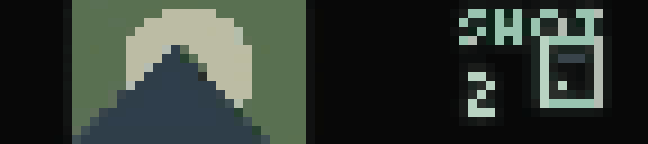

# Photo Cull

Review thumbnails from a local photo shoot and export the names you mark for retouching.

Make a shortlist on a small second screen and hand the filenames to your retouching workflow. Marking a photo updates a separate selection file, so the source photograph stays untouched.

## Mark the first keepers

1. Start the companion in the photo folder and turn the wheel to browse its thumbnails. The rear identifies the file.
2. Click a shot you want to keep. Its front label changes from **SHOT** to **KEEP**. Click the same shot again to remove its mark.
3. Turn to the next candidate and compare the thumbnail before choosing. In the first clip the first image becomes a keeper and the next image appears.


## Export names for retouching

1. Click to keep the second candidate. **Start** writes `busybar-selection.txt` in the photo folder.
2. Open the text file on the computer to see the selected names. Returning to the folder in a later session reloads its saved selection.
3. Use the full-resolution image on your computer to check sharpness. The bar thumbnail is intended for identifying frames and grouping likely keepers.



## Example from the emulator

The test used three generated JPEGs. Two frames, 014 and 022, were selected and exported. The original files had the same checksums after the review. The bar only needed a small thumbnail for each image. Three generated JPEG photographs processed by the real Pillow thumbnail and selection pipeline.

## Set up the source

Install Pillow (python3 -m pip install Pillow) and run python3 companion/serve.py /path/to/photos. Set bridge to http://127.0.0.1:8770/reading in the emulator. Turn to browse, click to toggle selection and Start to export busybar-selection.txt in the folder. Selections persist in a separate hidden JSON file. Supported images include JPEG, PNG, TIFF, BMP and WebP. For hardware, use --bind with your computer's LAN address on a trusted local network and use that address in the URL.

## Run in the emulator

Open BUSY Bar Emulator. From this repository, run:

```sh
~/.busy-emulator/bin/busy-emulator dev --once
```

Press **Back** to exit.

The GIFs are excerpts from the emulator recording. Each front-display pixel is shown at 9× its original width and height. The end frames pause for reading.

[Full recording](media/controls.mp4) · [Rear display](screenshots/back-1.png) · [Firmware test](EMULATOR-QA.md) · [MIT license](LICENSE)
